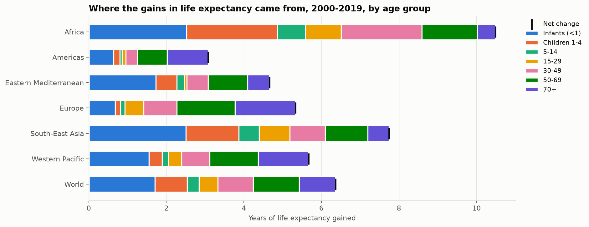
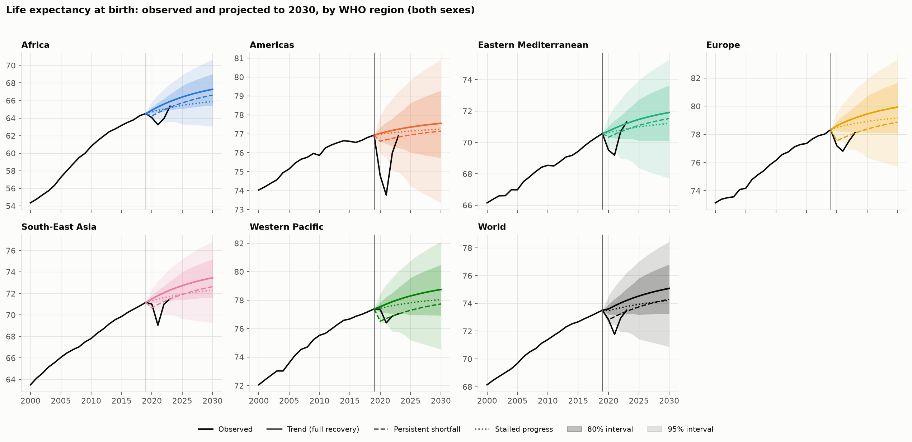

# Life Expectancy: What Changed, Why, What Next, and What Could Be Done

How has life expectancy changed across the world since 2000? **Which ages and causes** drove the gains and the COVID-19 losses? **Where is it heading** by 2030, and how sure can we be? And **how many years of life** would meeting the SDG health targets be worth?

This project uses official **WHO Global Health Observatory** data (life expectancy, healthy life expectancy and full life tables by age and sex) and **World Bank** indicators. It aims to follow public health analysis standards: transparent sources, results by sex and region, demographic methods, tested forecasts with honest uncertainty, and clearly stated assumptions.

<!-- Once you've run the notebooks, add your two most striking charts here, e.g.:


-->

## Key findings

*Paste the auto-generated summaries from the end of notebooks 02, 03 and 04 here, then add one sentence of explanation and a citation to each.*

- **What changed:** ...
- **Why:** ...
- **What next (2030):** ...
- **What could be done:** ...

## The analysis

| Notebook | Question | Methods |
|---|---|---|
| `01_eda` | What happened? | Data coverage, population-weighted regional trends, sex gap, COVID-19 drop, HALE vs life expectancy, income gradient |
| `02_why_it_changed` | Why did it change? | **Arriaga life-table decomposition** of gains (2000-2019) and COVID losses (2019-2021) by age, sex and region; cause-related mortality trends; epidemiological transition; **two-way fixed-effects** panel regression of drivers |
| `03_forecasts_to_2030` | Where is it heading? | Naive, drift and damped baselines vs a **pooled convergence model** (gradient boosting across all countries); **rolling-origin backtests**; empirical prediction intervals with an out-of-sample coverage check; recovery / persistent-shortfall / stalled-progress **scenarios** |
| `04_prevention_scenarios` | What could be done? | **Life-table counterfactuals**: years gained by meeting SDG 3.2 (under-5 mortality ≤ 25 per 1,000), SDG 3.4 (premature NCD mortality cut by a third), both, or matching regional best performers |

### Why these methods
- **Life expectancy is a summary of death rates by age**, so decomposing its change by age is an exact accounting, not a model. It is the most rigorous first step in explaining *why* it changed. Life expectancy rebuilt from WHO's death rates is checked against WHO's published figures before use.
- **Fixed effects** compare each country with itself over time, removing stable differences between countries that make simple correlations misleading.
- **Forecasts must beat simple baselines in backtests** before they're trusted, and their intervals come from their real past errors.
- **Shocks are handled with scenarios**, because no statistical model can forecast a pandemic or a funding collapse.

## What the forecasts presume
1. Countries follow the path they and similar countries were on before 2020.
2. COVID-19 is a shock, not a new trend; scenarios bound the recovery.
3. WHO estimates are taken as the observed truth (many are themselves modelled).
4. Prediction intervals cover normal forecast error as measured in 2009-2019, not major shocks.

## Data

| Source | What |
|---|---|
| [WHO Global Health Observatory](https://www.who.int/data/gho) | Life expectancy and HALE at birth by sex (`WHOSIS_000001`, `WHOSIS_000002`); life tables: age-specific death rates (nMx) by sex, 2000-2021 |
| [World Bank WDI](https://data.worldbank.org/) | Income, health spending, immunization, HIV, schooling, water, sanitation, undernourishment, urbanisation, population; under-5, neonatal, maternal and adult mortality; premature NCD mortality; HIV, TB and malaria incidence; road traffic and suicide deaths; cause-of-death shares |

Everything is downloaded from the official APIs by `src/fetch_data.py`. The life-table indicator code is looked up from WHO's indicator catalogue by name, and the code used is logged. All indicator codes are listed in `src/config.py`.

## Project structure

```
life-expectancy-forecasting/
├── data/
│   ├── raw/                 # API downloads (not committed; recreate with fetch_data)
│   ├── processed/           # analysis panel + life tables
│   └── external/            # optional: UN WPP projections for comparison
├── notebooks/               # 01-04, run in order
├── reports/figures/         # charts saved by the notebooks
├── src/
│   ├── config.py            # paths and indicator codes
│   ├── fetch_data.py        # WHO + World Bank API downloads
│   ├── build_dataset.py     # merge into panel and life tables
│   ├── lifetable.py         # life tables, Arriaga decomposition, counterfactuals
│   ├── analysis.py          # weighting, decomposition, fixed effects, prevention scenarios
│   ├── forecasting.py       # baselines, convergence model, backtests, intervals, scenarios
│   └── plotting.py          # shared chart style (colorblind-safe palette)
├── run_all.py               # runs the whole pipeline in one command
├── tests/                   # 18 tests: parsers, life-table maths, forecasting
└── requirements.txt
```

## How to run

Requires Python 3.10 or newer.

```bash
git clone https://github.com/<your-username>/life-expectancy-forecasting.git
cd life-expectancy-forecasting

python -m venv .venv
source .venv/bin/activate        # Windows: .venv\Scripts\activate
pip install -r requirements.txt

python run_all.py                # download data, build datasets, run tests, run all 4 notebooks
jupyter lab                      # open the notebooks to read the results
```

## Limitations

- WHO life expectancy and life tables are **modelled estimates**. Where death registration is incomplete, especially in low-income countries and for 2020-2021, uncertainty is substantial.
- Cause-related analysis uses summary indicators, not full cause-of-death data by age. A natural extension is cause-by-age decomposition using WHO's Global Health Estimates.
- The NCD share of deaths at 30-69 is approximated from two published probabilities under a competing-risks assumption, and applied equally to both sexes.
- Fixed-effects estimates are associations within countries, not proven causal effects.
- Forecasts don't account for future shocks, policies or new technologies; scenarios bound some of that uncertainty.

## References
- Arriaga, E. (1984). Measuring and explaining the change in life expectancies. *Demography* 21(1).
- Preston, S., Heuveline, P. & Guillot, M. (2001). *Demography: Measuring and Modeling Population Processes*.
- Andreev, E. & Kingkade, W. (2015). Average age at death in infancy and infant mortality level. *Demographic Research* 33.
- WHO (2025). *World Health Statistics 2025*.
- UN IGME (2025). *Levels and Trends in Child Mortality*.

## Author

*Linet Muthoni* · Data Science student · [linetmaina.r@gmail.com](#)
