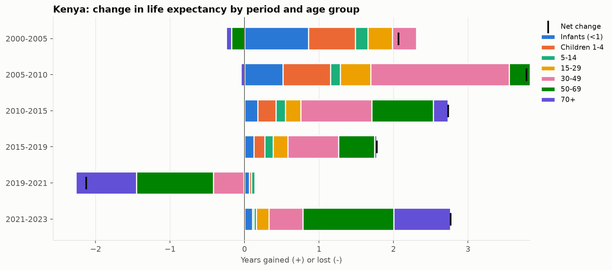
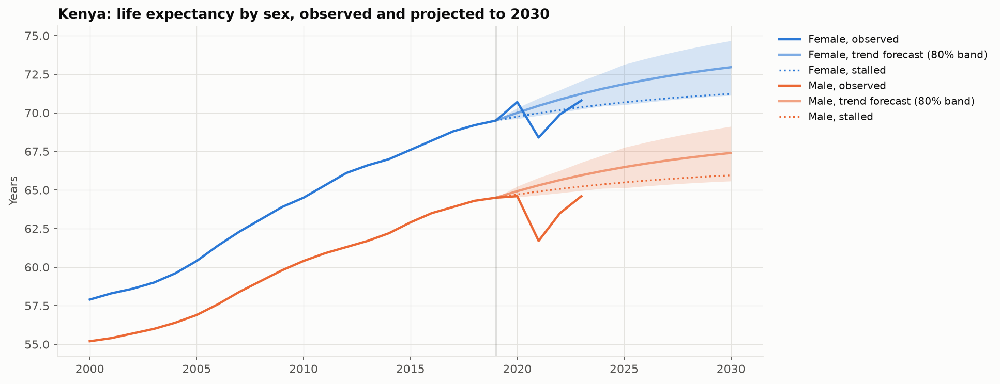

# Life expectancy: what changed, why, and what's next


I wanted to understand what has actually driven changes in life expectancy since 2000, not just predict it. So this project uses WHO life tables and World Bank data for 185 countries (2000-2023) to look at which age groups drove the gains, what COVID-19 did, where life expectancy is heading by 2030, and how many years meeting the SDG health targets would add. I look at Kenya in more detail.



## Findings

**What changed**
- Between 2000 and 2019 life expectancy rose by 6.4 years on average across countries (population-weighted). About 40% of that came from fewer deaths before age 5.
- Africa gained the most, from 54.3 years in 2000 to 65.4 in 2023. Rwanda (+21.4 years) and Burundi (+20.1) had the biggest gains of any country.
- In Europe and the Americas most of the gain came from people over 50. In Africa and South-East Asia it came mostly from children.

**COVID-19**
- Life expectancy fell by 1.7 years between 2019 and 2021, close to WHO's own figure of 1.8. Deaths over age 50 account for 1.4 years of that.
- The Americas were hit hardest (-3.3 years). Peru lost 8.4 years.
- By 2023 most regions had recovered to their 2019 level, but the Americas, Europe and the Western Pacific were still slightly below it. Two thirds of countries were still below where their pre-COVID trend would have put them, by 0.7 years on average.

**Kenya**
- Life expectancy went from 56.6 in 2000 to 67.0 in 2019, dropped to 64.9 in 2021 and was 67.6 in 2023.
- The fastest progress was 2005-2010 (+3.8 years), and almost half of it came from ages 30-49. This lines up with HIV treatment: Kenya made antiretroviral drugs free in public facilities in 2006 ([Oti et al. 2013](https://www.springermedizin.de/hiv-mortality-in-urban-slums-of-nairobi-kenya-2003-2010-a-period/9495522)), and HIV prevalence fell from 8.8% to 3.9% over 2000-2019. Before that, in 2000-2005, the gains were mostly in infants and young children.
- Women and men have recovered from COVID very differently. Women went from 69.5 in 2019 to 70.8 in 2023, but men only from 64.5 to 64.6. The gap between them is now over 6 years, and men are still below their pre-COVID trend. I think this is worth looking into further.



**Why (drivers)**
- Comparing each country with itself over time (fixed effects), better access to basic drinking water and higher DTP3 vaccination coverage were clearly linked to longer life expectancy.
- Income was strongly linked when comparing rich and poor countries, but not significantly once each country is compared with itself. This is similar to what Preston (1975) found. These are associations, not proof of cause.

**Outlook to 2030**
- The best forecasting method in backtests was a damped trend (average error 0.73 years, against 1.14 for assuming no change). Its 80% intervals contained 78% of outcomes they weren't built from, so the uncertainty ranges are about right.
- If progress returns to its pre-COVID path, world life expectancy would reach about 75.1 by 2030 (80% range 73.3-76.8). If progress stalls at half pace it would be 74.2.
- For Kenya: 70.2 by 2030 (68.4-71.9), or 68.6 if progress stalls.
- Africa has the most to gain and the most to lose: stalled progress would cost it 1.4 years by 2030, more than any other region.

**Prevention**
- Using 2019 death rates, meeting the SDG target for under-5 mortality would add 0.8 years to world life expectancy, and cutting premature NCD deaths by a third would add 1.3 years. Both together: 2.1 years.
- Africa is the only region where child survival still matters more than NCDs (3.3 years vs 1.1). 118 of 185 countries already meet the under-5 target.
- In Kenya the two are now about equal: 1.2 years from child survival and 1.1 from NCDs.
- Men would gain more than women from NCD prevention in every region, most of all in Europe (1.5 vs 0.9 years).

## Notebooks

| | |
|---|---|
| `01_eda` | trends, sex gap, COVID drop and recovery, HALE |
| `02_why_it_changed` | Arriaga decomposition by age, cause-related mortality, fixed-effects drivers |
| `03_forecasts_to_2030` | backtested forecasts, prediction intervals, scenarios |
| `04_prevention_scenarios` | years gained if SDG 3.2 / 3.4 targets were met |

## Data

- [WHO Global Health Observatory](https://www.who.int/data/gho): life expectancy and HALE by sex, life tables (nMx)
- [World Bank WDI](https://data.worldbank.org/): economic, health and mortality indicators

All downloaded from the APIs, codes in `src/config.py`.

## Running it

```bash
python -m venv .venv
.venv\Scripts\activate          # Mac/Linux: source .venv/bin/activate
pip install -r requirements.txt
python run_all.py               # fetch data, build, test, run notebooks
```

`python run_all.py --skip-fetch` reruns without downloading again.

## Limitations

- WHO's life expectancy figures are modelled estimates, especially for countries with incomplete death registration and for 2020-2021, so they carry real uncertainty.
- The Central African Republic looks odd in the latest WHO release: 42.2 years in 2019, against 52.9 in WHO's previous release ([source](https://statisticsoftheworld.com/country/central-african-republic/WHO.LIFE_EXP)), with big swings in 2020 and 2021. I kept it in but it inflates CAR's numbers in the forecast and prevention tables.
- WHO's API only gives death rates up to "85+". For long-lived countries this makes life expectancy rebuilt from the life tables up to 1.5 years higher than WHO's published value (average difference 0.15 years), so the 70+ part of the decomposition is less precise there.
- The fixed-effects results are associations, not causal effects, and many of the World Bank indicators are themselves modelled.
- Forecasts assume countries continue on their pre-COVID paths. They don't include future shocks, policies or funding changes, and they are less accurate for Africa and the Eastern Mediterranean (average error about 1.2 years, against 0.4 for Europe).
- In the prevention scenarios the NCD share of deaths is an approximation, and the same share is used for women and men.

## References

- Arriaga (1984), Measuring and explaining the change in life expectancies, *Demography* 21
- Preston (1975), The changing relation between mortality and level of economic development, *Population Studies* 29
- Raftery et al. (2013), Bayesian probabilistic projections of life expectancy for all countries, *Demography* 50
- Aburto et al. (2022), Quantifying impacts of the COVID-19 pandemic through life-expectancy losses, *International Journal of Epidemiology* 51
- Oti et al. (2013), HIV mortality in urban slums of Nairobi, Kenya 2003-2010, *BMC Public Health* 13
- WHO (2025), *World Health Statistics 2025*
